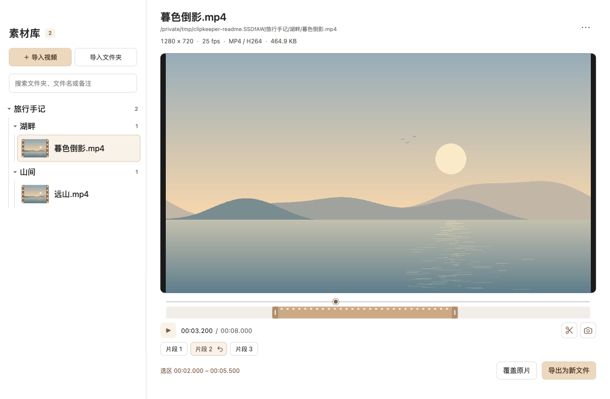

# 拾光 · ClipKeeper

拾光是一款本地视频粗剪工具。在导入剪辑软件之前，先翻看拍过的镜头，把值得留下的片段选出来。导入素材时，原片保留在原文件夹。



## 主要功能

- **素材库**：批量导入视频或整个文件夹，保留目录层级，支持按文件夹名、文件名或备注搜索。
- **预览与截图**：查看分辨率、帧率和拍摄设备（若有记录），点击相机图标即可将当前画面保存为 PNG。
- **粗剪与切分**：拖动手柄或在触摸板上双指张合，调整选区。点击剪刀可在播放头处切分，再点片段旁的回弯箭头可撤销切分。
- **片段导出**：选中片段后可另存为新文件，也可确认后覆盖原片。保存时可添加备注，方便下次查找。

导出使用 H.264（8-bit），保留主视频和首条音轨。处理 HDR 或多音轨素材时，建议另存为新文件。

## 本地运行

安装 Node.js 22.12 或更高版本，在项目目录运行：

```sh
npm ci
npm start
```

运行 `npm run package` 可打包桌面应用。在 Apple Silicon Mac 上，双击 `dist/ClipKeeper-darwin-arm64/ClipKeeper.app` 即可打开。
